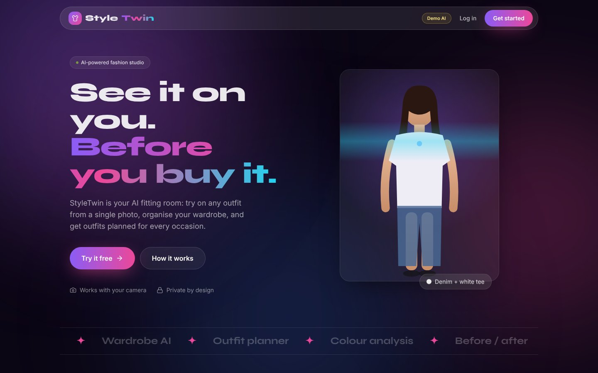
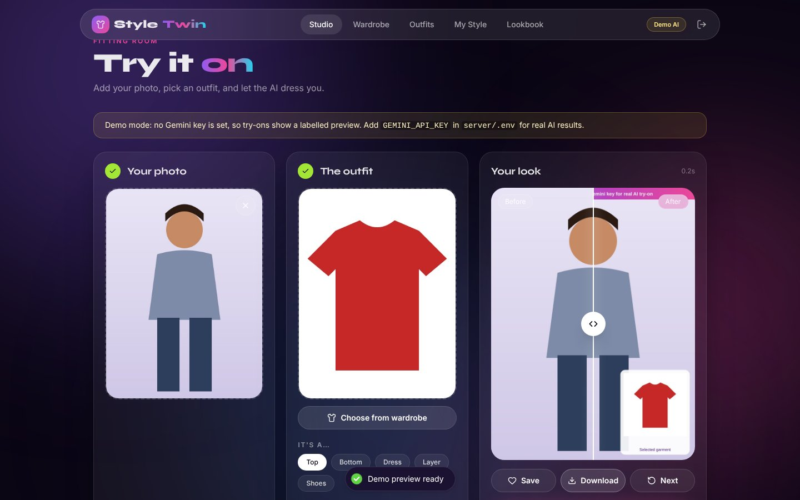
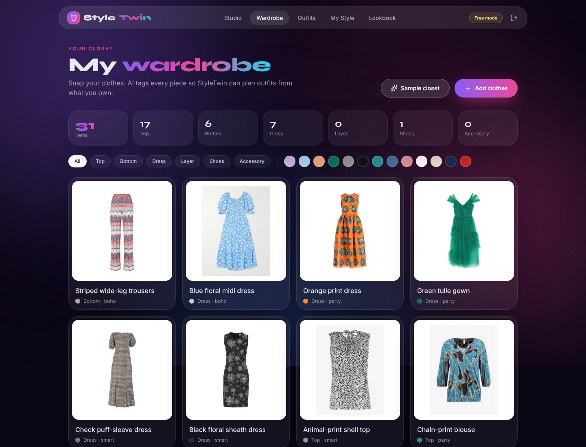
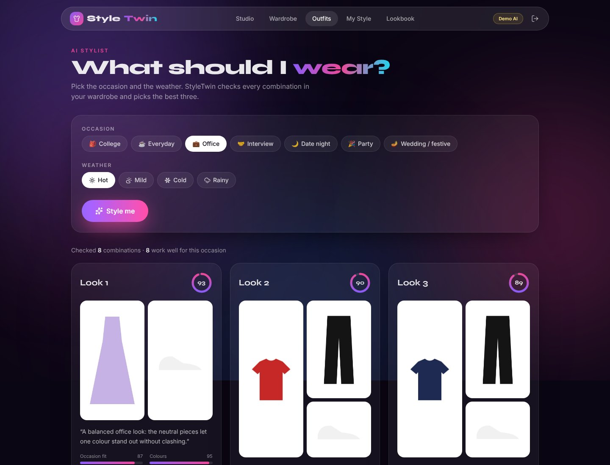
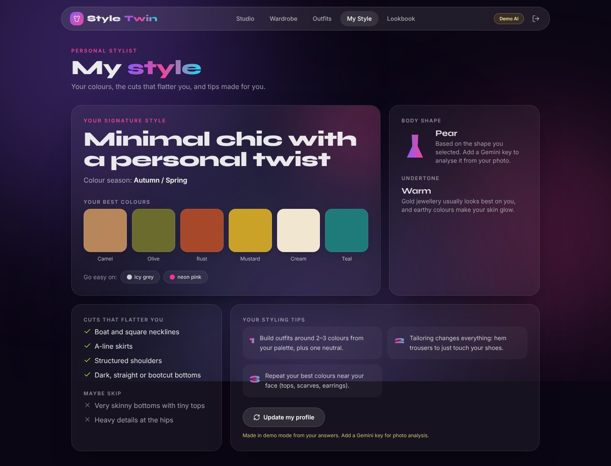
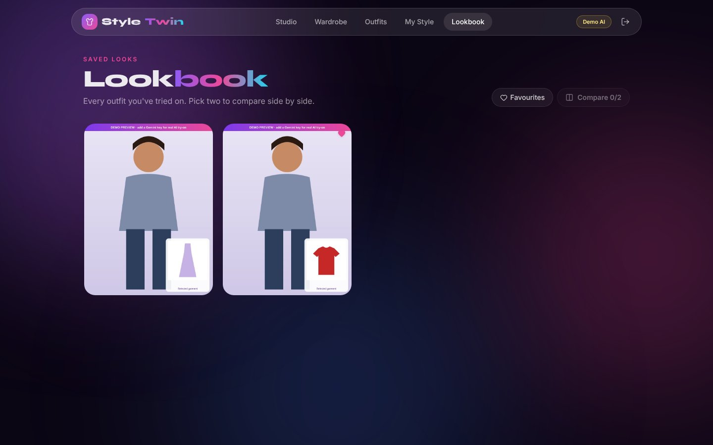
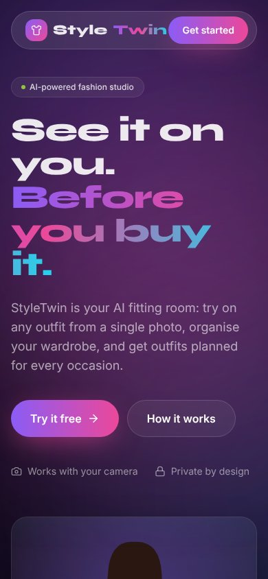

# StyleTwin

**See it on you. Before you buy it.**

StyleTwin is an AI fitting room. Upload one photo of yourself (or use your camera), pick any piece of clothing, and a diffusion model dresses you in it. It works out of the box with **no API key**: try-on runs on the open-source IDM-VTON model for free. It also keeps a smart wardrobe, plans complete outfits for any occasion and weather, and builds a personal style profile with your best colours and cuts.



## Features

- **AI virtual try-on.** Your photo plus a garment photo go to a try-on model, which returns you wearing it. Free by default with [IDM-VTON](https://github.com/yisol/IDM-VTON) (tops and jackets, about 20–60 s); with a billed Gemini key, Gemini 2.5 Flash Image handles every clothing type. A drag slider compares before and after. Save, download, or try the next piece without re-uploading yourself.
- **Sample closet and sample models.** One click adds 23 real product photos (tops, jeans, trousers, dresses) with hand-checked tags, and four sample models are ready in the Studio, so the whole app can be tried in under a minute.
- **Smart wardrobe.** Upload up to 10 clothes at once. AI names and tags each one: category, colour (with hex), pattern, style, formality level and season. Filter by type or colour, edit any tag.
- **Outfit planner.** Pick an occasion (college, office, interview, date, party, festive) and the weather. StyleTwin checks every combination you own and ranks the best three. Each look gets a score for occasion fit, colour harmony, weather and pattern balance, with a stylist note.
- **Style profile.** Body shape and skin undertone (from your photo or your answers) give you a colour palette, colours to go easy on, cuts that flatter you and personal tips. Written to be kind and body-positive.
- **Lookbook.** Every try-on is saved. Mark favourites and compare two looks side by side.
- **Camera capture.** Take your photo straight from the webcam or phone camera.
- **Never a dead end.** Each AI step falls back gracefully (Gemini → free model → labelled preview) and tells the user why, so a quota limit or outage never breaks the app.

## Screenshots

| Try-on studio | Wardrobe |
|---|---|
|  |  |

| Outfit planner | Style profile |
|---|---|
|  |  |

| Lookbook | Mobile |
|---|---|
|  |  |

Screenshots were taken offline in demo mode, so the try-on shown is the labelled preview. With an internet connection the free model returns a real try-on.

## Tech stack

| Layer | Tools |
|---|---|
| Frontend | React 18, Vite, Tailwind CSS, Framer Motion, React Router, lucide-react |
| Backend | Node.js, Express (ES modules), built-in `node:sqlite` |
| AI | IDM-VTON diffusion model (free Hugging Face Space, called over Gradio's HTTP queue API) for try-on; Google Gemini (`@google/genai`): `gemini-2.5-flash` for tagging and styling, `gemini-2.5-flash-image` for paid try-on |
| Images | sharp (auto-rotate, resize, strip EXIF and GPS data), multer |
| Security | JWT auth, bcrypt, helmet, rate limiting (login and try-on) |

## How it works

```
Browser (React)
   │  photo + garment
   ▼
Express API ──► sharp: rotate, resize, strip location data ──► uploads/<user>/
   │
   ├─ /api/wardrobe  ► Gemini tags the garment (JSON)   ┐
   ├─ /api/tryon     ► Gemini Image ─► IDM-VTON (free) ─► labelled preview
   ├─ /api/style     ► Gemini reads shape + undertone   ┘  demo fallback if no key
   └─ /api/style/outfits ► rule engine scores every combination
                          (formality 38%, colour harmony 32%, weather 18%, pattern 12%)
   │
SQLite (users, garments, try-ons, style profiles)
```

The outfit planner is deterministic, so it is fast and free. Colour harmony uses real colour theory (neutrals, analogous and complementary hues) on the hex value detected from each photo.

## Run it locally

You need **Node.js 22.13 or newer** (it uses Node's built-in SQLite, so there is nothing to compile and no database to install).

**1. Backend**

```bash
cd server
npm install
cp .env.example .env      # on Windows: copy .env.example .env
npm run dev               # http://localhost:5002
```

**2. Frontend** (new terminal)

```bash
cd client
npm install
npm run dev               # http://localhost:5173
```

Open http://localhost:5173 and create an account. Fastest tour: **Wardrobe → Sample closet**, then **Studio → pick a sample model → Choose from wardrobe → a top → Try it on**.

**3. More AI (optional)**

Try-on already works for tops with no key. For more:

- `HF_TOKEN`: a free [Hugging Face token](https://huggingface.co/settings/tokens) gives the free try-on a bigger daily quota.
- `GEMINI_API_KEY`: a free key from [Google AI Studio](https://aistudio.google.com/apikey) turns on AI clothes tagging, photo-based style analysis and stylist notes. Turn on billing for that key to also use Gemini try-on for dresses, bottoms and shoes.

Put them in `server/.env` and restart the server.

## Environment variables

| File | Variable | Default | Purpose |
|---|---|---|---|
| `server/.env` | `PORT` | `5002` | API port |
| | `CLIENT_URL` | `http://localhost:5173` | Allowed origin for CORS |
| | `JWT_SECRET` | random per run | Signs login tokens. Set one so logins survive restarts |
| | `HF_TOKEN` | empty | Optional free Hugging Face token, bigger try-on quota |
| | `FREE_TRYON` | `on` | `off` disables the free IDM-VTON try-on |
| | `GEMINI_API_KEY` | empty | Empty means tagging and style run in demo mode |
| | `GEMINI_TRYON` | `on` | `off` skips Gemini for try-on (saves billed calls) |
| | `GEMINI_MODEL` | `gemini-2.5-flash` | Text and vision model |
| | `GEMINI_IMAGE_MODEL` | `gemini-2.5-flash-image` | Try-on image model |
| `client/.env` | `VITE_API_URL` | `http://localhost:5002` | Where the frontend finds the API |

## API

| Method | Route | What it does |
|---|---|---|
| POST | `/api/auth/register`, `/api/auth/login` | Create account, sign in |
| GET / DELETE | `/api/auth/me` | Current user, delete account and all photos |
| GET / POST | `/api/wardrobe` | List with stats and gaps, upload up to 10 garments |
| POST | `/api/wardrobe/samples` | Add the 23-piece sample closet |
| PATCH / DELETE | `/api/wardrobe/:id` | Edit tags, remove |
| POST | `/api/tryon` | Run a try-on (new photo or reuse one, wardrobe item or new garment) |
| GET / PATCH / DELETE | `/api/tryon`, `/api/tryon/:id` | Lookbook, favourite, delete |
| GET / POST | `/api/style` | Style profile, analyse |
| POST | `/api/style/outfits` | Plan outfits for an occasion and weather |

## Privacy

Photos are stored only on your own server, resized, and stripped of EXIF and GPS data. Deleting your account deletes every photo you uploaded.

## Credits and licences

- Try-on model: [IDM-VTON](https://github.com/yisol/IDM-VTON) (Choi et al., ECCV 2024), used through its public Hugging Face Space.
- Sample clothes and models in `server/samples/` come from the example sets of [IDM-VTON](https://github.com/yisol/IDM-VTON) (VITON-HD) and [OOTDiffusion](https://github.com/levihsu/OOTDiffusion) (Dress Code), shared under [CC BY-NC-SA 4.0](https://creativecommons.org/licenses/by-nc-sa/4.0/). They are included for non-commercial demo use only.

## Author

**Megha Raykar** · [GitHub](https://github.com/Megharaykar27) · [LinkedIn](https://www.linkedin.com/in/meghxcoder)
